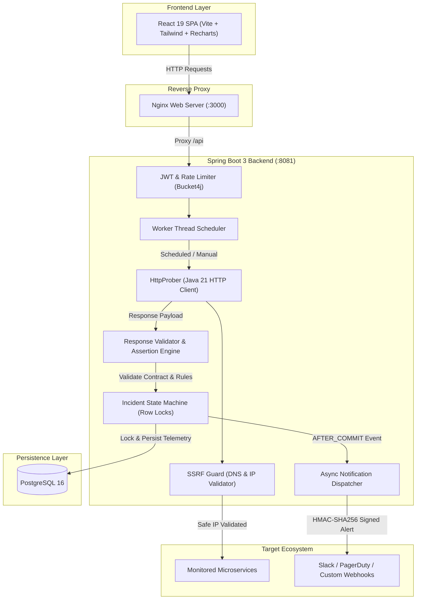

# API Sentinel 🛡️
> High-Throughput Silent API Failure Detector & Automated Health Monitoring Engine

[](https://github.com/Its-sourabh86/api-sentinel/actions/workflows/ci.yml)


---

## 📌 Problem Statement: The "Silent API Failure"
Traditional uptime checkers (e.g., UptimeRobot, Pingdom) only verify if an endpoint returns `HTTP 200 OK`. 

In production, **silent failures** occur when an API returns `HTTP 200`, but:
- The JSON response contains an empty payload or error object (`{"data": []}`, `{"error": "null pointer"}`).
- Business metrics violate contracts (e.g., inventory stock `<= 0` or timestamp is stale).
- The JSON schema underwent an unannounced breaking change.

**API Sentinel** is a distributed, high-concurrency monitoring system designed to detect silent failures, prevent Server-Side Request Forgery (SSRF), and dispatch tamper-proof HMAC-signed webhook notifications.

---

## 🏛️ System Architecture



---

## 🚀 Key Engineering Highlights

### 1. SSRF Defense-in-Depth (`UrlSafetyValidator`)
- **DNS Resolution Inspection:** Validates every resolved IP address against RFC1918 (Private IP ranges), IPv4 Loopback (`127.0.0.0/8`), Link-Local / Cloud Metadata endpoints (`169.254.169.254`), and IPv6 Unique Local Addresses (`fc00::/7`).
- **Redirect Hop Budgeting:** Prevents redirect chains and SSRF bypasses via open-redirects by re-validating target IPs on every hop with a cumulative execution timeout budget.
- **DNS Rebinding Awareness:** Limits TOCTOU (Time-of-Check to Time-of-Use) exposure with aggressive DNS caching and connection-time resolution.

### 2. State-Machine Incident Engine & Dedup
- **Row-Level Locking:** Uses `SELECT ... FOR UPDATE` row locks to prevent race conditions during concurrent worker evaluations on the same monitor.
- **Configurable Thresholds:** Requires $N$ consecutive failures to declare an incident `OPEN` and $M$ consecutive successes to mark it `RESOLVED`.
- **Alert Suppression:** Events trigger strictly on status state-transitions (`OPENED`, `RESOLVED`), suppressing noise from continuous failing checks.

### 3. Secure Webhook Notification Engine
- **Transactional Decoupling:** Uses Spring's `AFTER_COMMIT` event listener phase. If the database transaction rolls back, phantom alerts are never dispatched.
- **HMAC-SHA256 Signatures:** Dispatches webhook requests with an `X-Sentinel-Signature` header computed via a shared secret, preventing spoofing and man-in-the-middle tampering.
- **Exponential Backoff:** Retries transient failures (5xx, 429, timeouts) with randomized exponential jitter while rejecting non-retryable 4xx bad requests.

### 4. Interactive Monitoring Dashboard
- **Recharts Telemetry Visualization:** Real-time p50 and p95 latency time-series graph with red visual flags for failed checks.
- **On-Demand Manual Prober:** Instant "Run Check Now" execution with zero scheduler wait-time.
- **Business Rule Builder:** JSONPath assertions (`>=`, `==`, `NOT_EMPTY`, `AGE_LTE`) and full JSON Schema draft-07 contract validator.

---

## 🛠️ Tech Stack

| Domain | Technology |
| :--- | :--- |
| **Backend** | Java 21, Spring Boot 3.4, Hibernate 7, Flyway, Maven |
| **Frontend** | React 19, TypeScript, Tailwind CSS, Recharts, Vite |
| **Database** | PostgreSQL 16 (with Flyway migration versioning) |
| **Security** | JWT Authentication, Bucket4j Token Bucket Rate Limiting, SSRF Validator |
| **DevOps & CI** | Docker, Docker Compose, Nginx, GitHub Actions CI |

---

## ⚡ Quickstart (One-Click Docker)

Ensure you have **Docker Desktop** installed. Clone and run:

```bash
# 1. Clone repository
git clone https://github.com/Its-sourabh86/api-sentinel.git
cd api-sentinel

# 2. Setup environment variables
cp .env.example .env

# 3. Spin up PostgreSQL, Backend, and Frontend in one command
docker compose up --build
```

Access the dashboard at:
👉 **`http://localhost:3000`**

---

## 💼 Resume Bullets (Ready to Paste)

* *Built **API Sentinel**, an end-to-end API failure detection platform in **Java 21, Spring Boot 3, and React 19**, detecting silent payload errors beyond HTTP status codes using JSONPath and JSON Schema validations.*
* *Engineered an **SSRF Defense-in-Depth pipeline** validating resolved IPs against loopback, RFC1918, and link-local cloud metadata endpoints (169.254.169.254) across multi-hop redirects with strict time budgets.*
* *Designed an **idempotent incident engine** with `SELECT ... FOR UPDATE` row locks, state-machine deduplication, and `AFTER_COMMIT` event listeners dispatching **HMAC-SHA256 signed** webhook alerts with exponential backoff.*
* *Architected a multi-stage **Docker Compose** containerization pipeline with an **Nginx reverse proxy** and automated **GitHub Actions CI** for parallel multi-tier testing.*